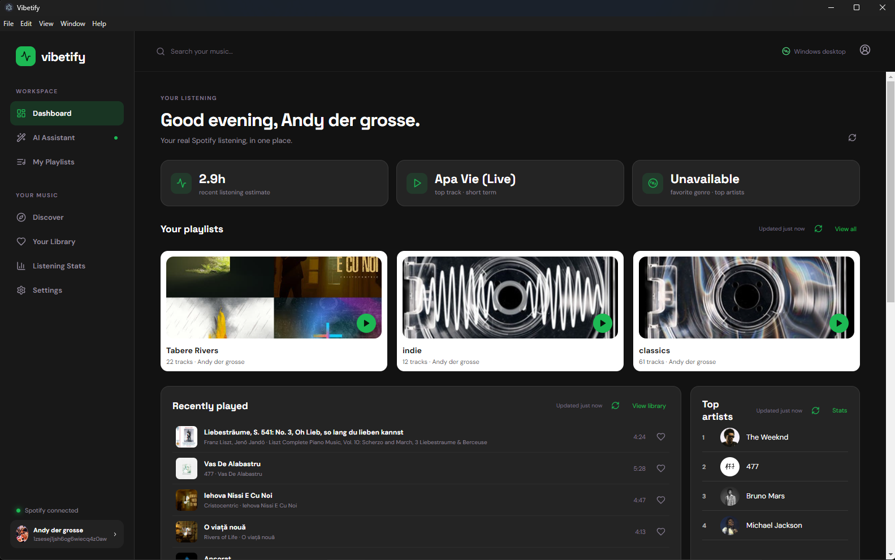
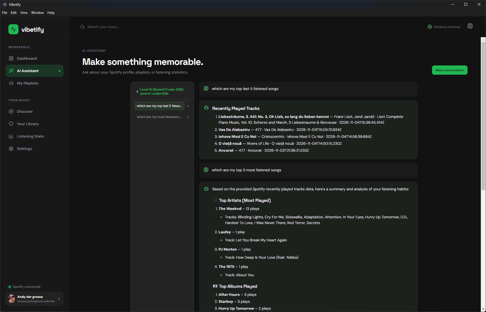
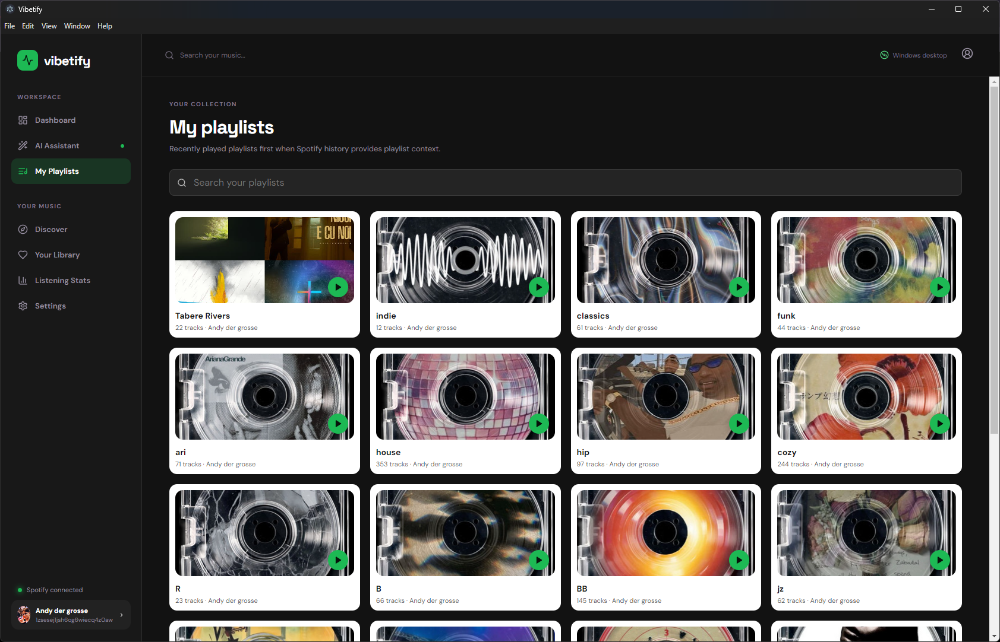
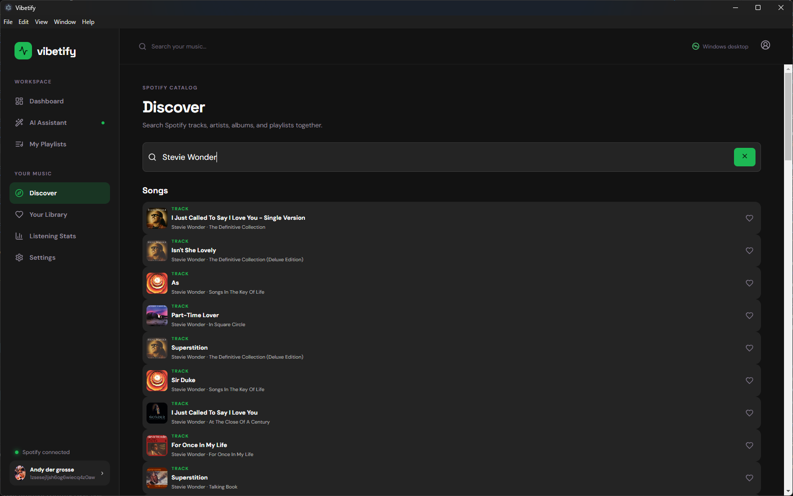
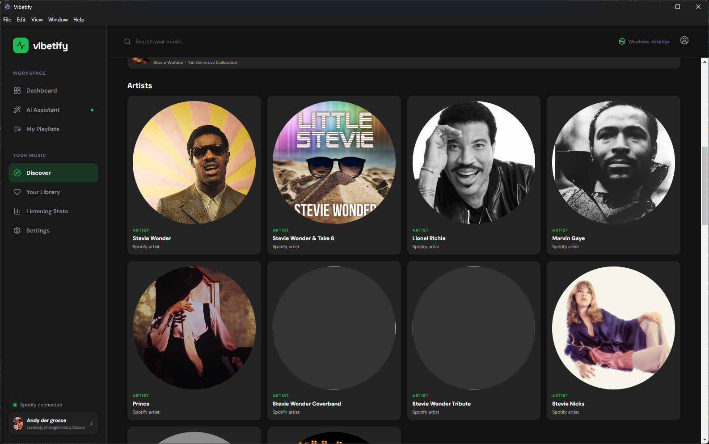
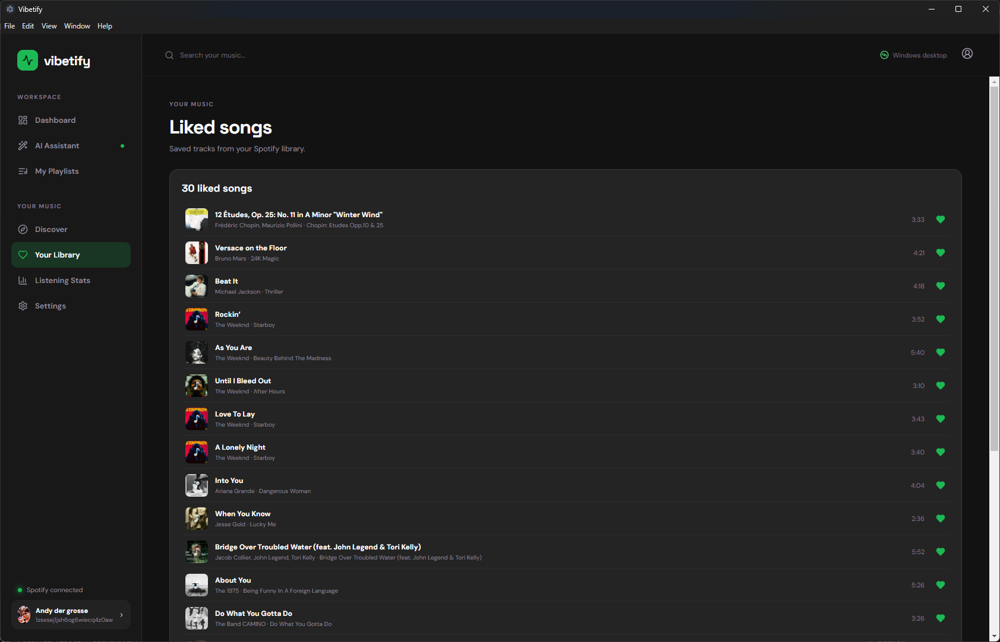
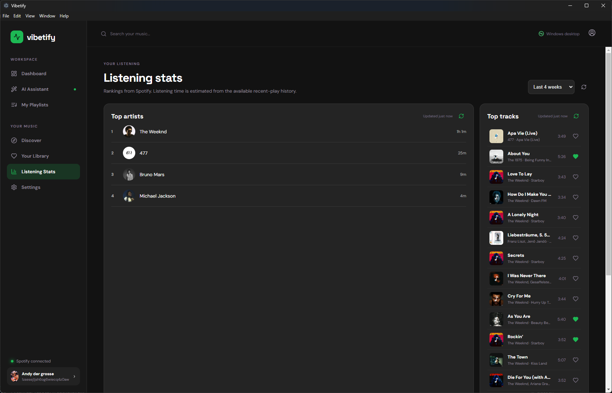
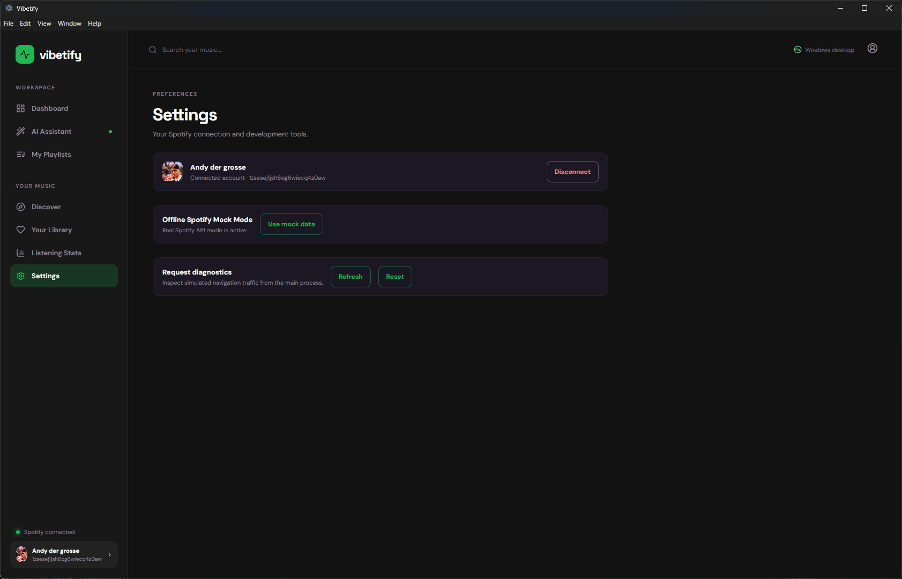

# Vibetify

Vibetify is a Windows desktop music workspace built with Electron, React, TypeScript, and Vite. It combines a Spotify-backed music-library interface with an AI assistant and secure token handling.

## Screenshots

### Dashboard


### AI Assistant


### My Playlists


### Discover




### Your Library


### Listening Stats


### Settings


*Discover is currently under development and will be showcased in a future update.*


## Quick Start (Git Bash)

Open three Git Bash terminals from your project directory.

**1. Start Ollama**

```bash
ollama serve
```
or 

```bash
ollama run qwen3-coder:30b
```

Leave ollama with:

```bash
/bye
```

or 
If Ollama is already running in the background, skip this step.

**2. Start the AI backend**

```bash
cd ~/Desktop/Vibetify
source ~/.config/vibetify/backend.env
npm run backend:dev
```

**3. Start Electron and Vite**

```bash
cd ~/Desktop/Vibetify
source ~/.config/vibetify/electron.env
npm run dev
```

**4. Start Backend and Electron and Vite**

```bash
cd ~/Desktop/Vibetify
source ~/.config/vibetify/backend.env
source ~/.config/vibetify/electron.env
npm run dev:full
```

Keep all three terminals open while using Vibetify.

The backend connects to Ollama automatically. You do not need to run `ollama run qwen3-coder:30b` separately.

## Architecture

- `electron/main.ts` creates the native Windows window and only exposes a validated external-link IPC action.
- `electron/preload.ts` provides the restricted context-isolated bridge.
- `src/` contains the React renderer, typed UI views, Spotify PKCE setup, and tests.
- `electron/spotify-api.ts` owns authenticated Spotify Web API calls; tokens never enter renderer JavaScript.
- Vite provides development HMR; Electron loads the Vite URL in development and packaged assets in production.
- Electron Builder creates a Windows x64 NSIS installer.
- `backend/` contains the provider-only AI service; it is deployed separately and is never bundled into the desktop installer.

## Development

```bash
npm install
npm run dev
```

The `dev` script starts Vite, waits for it to be ready, and opens Vibetify in its own Electron window. Renderer changes are hot-reloaded.

## Build and package

```bash
npm run typecheck
npm test
npm run build
npm run package:win
```

The installer is written to `release/`.

## Real AI backend

The default provider is the deterministic Mock AI. Real AI uses this flow:

```text
Electron main process -> authenticated backend -> Ollama or OpenAI
```

The OpenAI key is only read by the backend. Local Ollama is contacted only by the backend and remains bound to `127.0.0.1`; neither provider credential is accepted by preload or renderer code.

### Local backend

Copy `.env.backend.example` to a backend-only environment file and set real values:

- `AI_BACKEND_PROVIDER`: `ollama` or `openai`; defaults to `openai`.
- `OLLAMA_BASE_URL`: local Ollama URL, default `http://127.0.0.1:11434`.
- `OLLAMA_MODEL`: Ollama model, default `qwen3-coder:30b`.
- `OPENAI_API_KEY`: backend-only OpenAI API key.
- `OPENAI_MODEL`: model name, default `gpt-4.1-mini`.
- `AI_JWT_SECRET`: long random signing key for short-lived access tokens.
- `AI_BOOTSTRAP_TOKEN`: separate local bootstrap credential; never commit or package it.
- `AI_DEV_USER_ID`: local development subject identifier.
- `AI_BACKEND_PORT`: local listening port, default `8787`.
- `AI_RATE_LIMIT`, `AI_MAX_BODY_BYTES`, `OPENAI_TIMEOUT_MS`: safety limits.

For local Ollama, verify the model is installed:

```bash
ollama list
```

The Ollama server must be running before starting the backend.

To use OpenAI instead, set `AI_BACKEND_PROVIDER=openai` and configure `OPENAI_API_KEY` and `OPENAI_MODEL` in the backend environment file.

The Electron process checks backend/provider status and exchanges the bootstrap value for a 15-minute bearer token. The assistant shows the active provider and model, and does not silently fall back if Ollama is unavailable.

For hosted deployment, replace the local bootstrap endpoint with an OIDC/device-login flow or another reviewed identity provider; do not ship a shared bootstrap value to end users. Configure TLS, a real user directory, secret storage, token revocation/rotation, and a distributed rate limiter before exposing the service publicly. The current backend and Ollama defaults bind to localhost and are suitable only for controlled local development.

To return to Mock AI, set `AI_PROVIDER=mock` and restart Electron. Mock mode never contacts the backend or OpenAI.

## Spotify configuration

Copy `.env.example` to `.env` and set:

- `VITE_SPOTIFY_CLIENT_ID`: the Client ID from a Spotify Developer Dashboard application.
- `VITE_SPOTIFY_REDIRECT_URI`: a redirect URI registered in that application. The default is `http://127.0.0.1:5173/auth/callback`.
- `VITE_API_BASE_URL`: optional URL for a future server-side AI/token service.

The renderer starts Authorization Code with PKCE and requests the scopes required for profile, playlists, saved tracks, top items, and recently played data. Spotify access and refresh tokens are encrypted with Electron `safeStorage` in the main process.

Without a Client ID, the app remains in an explicit preview state and does not claim that Spotify is connected. The current UI includes real navigation, chat interactions, playlist creation in the session, and service boundaries; Spotify resource retrieval and destructive actions require the token service and confirmation workflow to be wired to the configured backend.

### Spotify Developer Dashboard

Register this exact redirect URI:

```text
http://127.0.0.1:5173/auth/callback
```

Electron owns port `5173` for the callback listener. In development, Vite intentionally runs on `http://127.0.0.1:5174` so the registered callback port remains available to Electron. The same callback URI is used by the packaged Windows application, so no second production redirect URI is required.

The existing `127.0.0.1:5173/auth/callback` value is retained; it was not silently changed. The previous failure happened because Vite served that path in the browser and no Electron process was listening for the returned authorization code.

## Real Spotify data

The dashboard and sections use these current Web API endpoints:

- `GET /v1/me`
- `GET /v1/me/playlists`
- `GET /v1/me/tracks`
- `GET /v1/me/top/artists`
- `GET /v1/me/top/tracks`
- `GET /v1/me/player/recently-played`
- `GET /v1/search` with a Development Mode-safe limit of 10

Playlists use Spotify-provided artwork and metadata. Liked songs, recently played tracks, top artists/tracks, and the selectable short-, medium-, and long-term top-item ranges are loaded from the authenticated account. Favorite genre is the most frequent genre among returned top artists; it is shown as unavailable when Spotify returns no genre metadata. Listening hours are an estimate based only on the returned recently played events and their actual track durations, not lifetime listening.

The application shows explicit disconnected, loading, empty, and error states instead of fake account statistics. Spotify Development Mode limits and account permissions can make some endpoints unavailable; those failures are surfaced in the relevant section.

Spotify requests are coordinated in the Electron main process. Identical in-flight requests are deduplicated, successful GET responses use short-lived caches, saved-library checks are reused, and 429 responses honor `Retry-After` with bounded exponential backoff and a shared cooldown. A `QUOTA_EXCEEDED` response is reported as a rate-limit/quota problem rather than an expired login.

The dashboard, recently played, top artists, and listening stats sections each provide a manual refresh button. Refresh requests bypass only the target endpoint's cached GET response, remain subject to the shared concurrency limit and cooldown, and keep the previously loaded data visible if the request fails. The renderer coordinates these resources through a shared in-memory store so the same recently-played and top-artist responses are reused across views, with a last-updated timestamp shown after the first successful load.

OAuth callback completion is independent of profile enrichment: after the authorization code is exchanged, encrypted credentials are written and the loopback browser callback receives its success page immediately. `/v1/me` profile loading runs afterward. A profile 429, including `QUOTA_EXCEEDED`, keeps the session connected and shows a temporary profile-unavailable message; only an invalid refresh token or explicit disconnect clears credentials.

## Navigation and library actions

Playlist cards and catalog results open internal Vibetify pages. Playlist contents use `GET /v1/playlists/{id}/items` through the Electron main process; the official Spotify URL is not the default navigation. Track, artist, and album pages are also internal and can link to one another. Playlist responses are normalized from the current `items.total` / `items.items.item` shape, with legacy `tracks.total` / `items.track` compatibility, and all playlist-item `next` pages are loaded.

Track hearts use the current generic library endpoints with Spotify URIs:

- `GET /v1/me/library/contains`
- `PUT /v1/me/library`
- `DELETE /v1/me/library`

The `user-library-read` and `user-library-modify` scopes are requested during OAuth. Library checks are batched in groups of 40 URIs, and the result is mapped back to the original track order, including duplicates. Existing sessions authorized before these scopes were added must be disconnected and reauthorized. Saved state is checked against Spotify and shared across the dashboard, playlists, Discover, and library views.

My Playlists and playlist details filter their already-loaded data locally. Discover uses one debounced `/v1/search` request with `track,artist,album,playlist` (Enter submits immediately) and presents grouped, type-labelled results. Search payloads are normalized before rendering: `null` slots, entries without an `id`/`name`, duplicate ids, and missing sections are dropped, so a partial Spotify response degrades to fewer results instead of an uncaught render error. Page content is wrapped in an error boundary that keeps the window usable and offers a retry. Listening Stats uses defensive handling for incomplete or unavailable recently-played history; displayed artist listening time is an estimate, not lifetime listening data.

The sidebar is fixed to the full Electron viewport while the main page scrolls independently. The default window is 1600×1000 with a 1200×800 minimum.

## Security

Electron runs with `contextIsolation`, `sandbox`, and `nodeIntegration: false`. The preload exposes no arbitrary filesystem, process, or IPC access. External links are validated in the main process before opening.

## Architecture

Desktop Framework: ELECTRON
Frontend: React
Backend: Node.js

Windows desktop Application that connects to a user's Spotify account through the Spotify Web API using OATH 2.0 Authentication
It retrieves real Spotify Data, such as playlists, songs, listening statistics etc.
Frontend built with React and Typescript, while Electron handles desktop functionality and communication with the backend
An integrated AI assistant uses local LLMs through Ollama or the OpenAI API to understand natural-language requests, retrieve Spotify information and perform actions such as creating or modifying playlists.